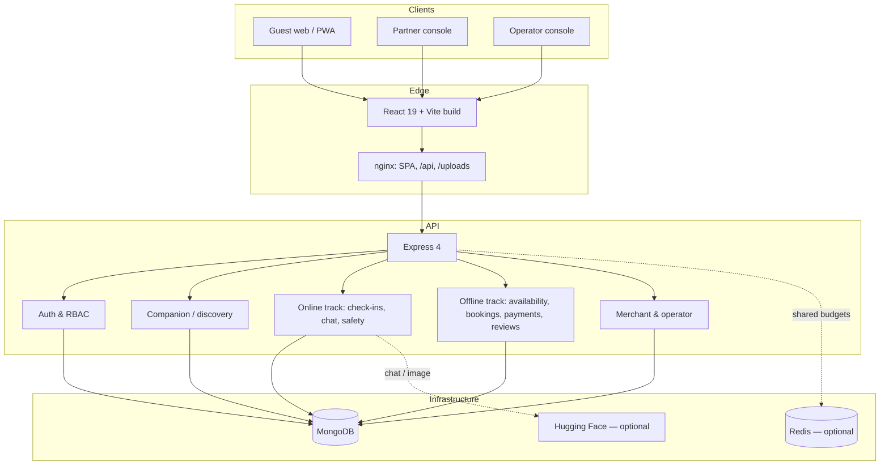
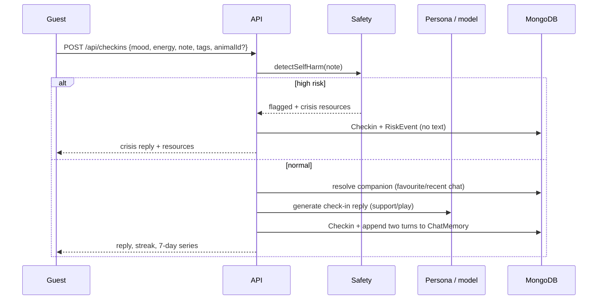
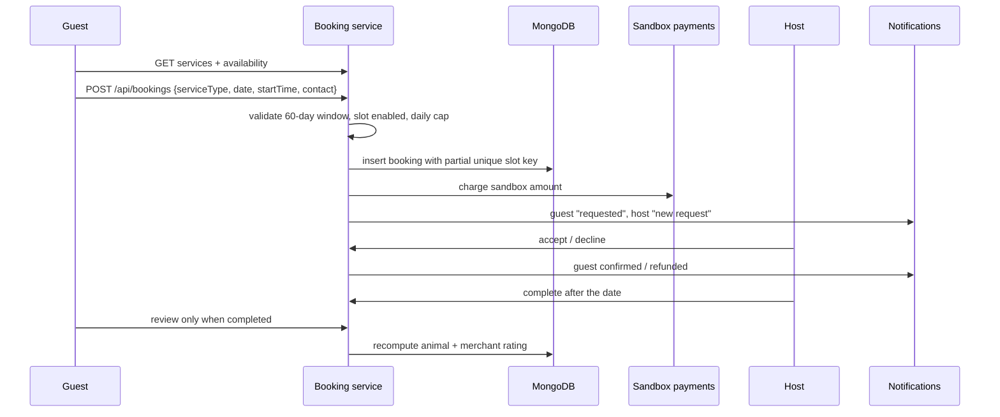
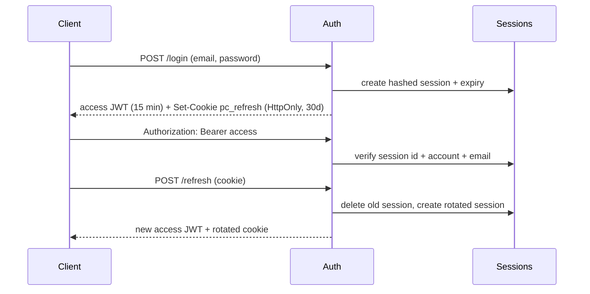

# PawCompanion Architecture

> An online + in-person pet companionship product. One relationship, two delivery tracks, a shared safety layer.

- [Product model](#product-model)
- [System context](#system-context)
- [Frontend architecture](#frontend-architecture)
- [Backend architecture](#backend-architecture)
- [Domain model](#domain-model)
- [Online companionship flow](#online-companionship-flow)
- [In-person companionship flow](#in-person-companionship-flow)
- [Authentication and sessions](#authentication-and-sessions)
- [Safety and risk](#safety-and-risk)
- [API conventions](#api-conventions)
- [Data integrity](#data-integrity)
- [Operations](#operations)
- [Trade-offs and limitations](#trade-offs-and-limitations)
- [Next steps](#next-steps)

---

## Product model

PawCompanion is not a pet marketplace. It is a companionship service built around a continuing relationship between a guest and an animal companion.

| Track | Delivery | Core loop |
| --- | --- | --- |
| **Online** | Digital pet, daily check-ins, journal, support mode | check in / talk → behaviour + animal sound + translated text → state/memory → bond |
| **In-person** | Home visit, walk, café meetup | discover → choose service/time → reserve → host confirms → visit → review |
| **Merchant** | Shelters, cafés, rescues and trainers | listing → availability → visit decisions → review replies |
| **Operations** | Trust and safety | risk queue → acknowledge/resolve, partner suspension, moderation, audit |

The two tracks share identity, the companion record, favourites, notifications and the safety profile. A check-in can create a conversation turn; a completed visit can prompt a review; both contribute to the private bond.

**Design principles**

1. **Companionship over catalogue.** The member home is about today's mood, the next visit and a continuing conversation, not a wall of products.
2. **Low pressure.** No streaks that punish, no forced subscription, no dark patterns around booking.
3. **Safety is a product surface.** The support mode, crisis card and privacy controls are first-class screens.
4. **Honest boundaries.** Sandbox payments and AI fallback are labelled, not disguised.
5. **Small, legible modules.** HTTP, domain services, persistence and validation are separate.

---

## System context



Deployment can be a single Node process plus MongoDB (demo), or a shared API behind a load balancer with Redis for cross-instance rate limits.

---

## Frontend architecture

```
src/
  App.jsx                 providers, error boundary, auth gate, router
  AppRoutes.jsx           route map, role guards, lazy page chunks
  components/
    Layout/               Header, Footer, SiteLayout, ConsoleLayout, MobileTabBar, NotificationBell
    Auth/                 AuthLayout, RequireAuth
    Home/                 MemberHome (the C-end dashboard)
    Companions/           CompanionCard, FilterBar, ReviewList
    Chat/                 ChatMessage
    Dashboard/            BarChart
    ui primitives         Icon, Logo, Rating, Modal, Field, EmptyState, Feedback
  context/                AuthContext, ToastContext, FavoritesContext
  hooks/                  useFetch, useDebouncedValue, useDocumentTitle
  lib/                    api client, formatting, constants
  pages/                  public, guest, partner, operator
  styles/                 design tokens, base, shared UI
```

**Key decisions**

- **Auth gate before route mount.** `AuthProvider` restores the session from the rotating refresh cookie before rendering routes. That prevents pages from fetching public data before the access token is attached, which otherwise loses auth-aware fields such as `relationship` and `isFavorite` on a hard reload.
- **Access token in memory, refresh cookie HttpOnly.** The frontend never stores a bearer token in `localStorage`. An Axios interceptor retries one failed request after a silent refresh.
- **Route-level code splitting.** Public shell, home and layout stay in the initial bundle; every other page is a lazy chunk. The initial production JS is ~316 kB / 98 kB gzip instead of a single ~600 kB bundle.
- **CSS Modules over tokens.** Colour, spacing, radius, shadow and type scales live in `styles/tokens.css`; shared primitives in `styles/ui.css`; page-specific composition in modules. No runtime CSS-in-JS.
- **Mobile as a first-class shell.** A fixed, safe-area-aware tab bar (Home / Discover / Check-in / Chats / Me) appears below 820 px. The toast viewport moves above it.
- **PWA.** Manifest, install shortcuts, theme colour, apple meta, and a production service worker that network-firsts navigation and cache-firsts hashed assets.
- **Accessibility.** Skip links, focus trapping in modals, semantic labels, `aria-*` state on pickers and tabs, visible focus rings, reduced-motion support.

**State model**

| State | Owner | Lifetime |
| --- | --- | --- |
| Access token / user | `AuthContext` + `lib/api` | Memory; restored via refresh |
| Refresh token | HttpOnly cookie | 30 days, rotated on refresh |
| Favourites set | `FavoritesContext` | Session |
| Toasts | `ToastContext` | Ephemeral |
| Server data | `useFetch` per page | Component lifetime; explicit `refetch` |
| Check-in draft | `CheckinPage` local state | Page lifetime |

No global store is needed at this size. Optimistic updates are limited to favourites; bookings and check-ins refetch after mutation because server pricing, streaks and safety results are authoritative.

---

## Backend architecture

```
src/
  app.js                  middleware, route mounting, static uploads, error boundary
  server.js               connect, index sync, schedulers, graceful shutdown
  config/
    env.js                validated runtime configuration
    db.js                 Mongo lifecycle + structured events
  middleware/
    auth.js               access-token verification, session check, roles
    requestContext.js     request ID + structured HTTP log
    errorHandler.js       AppError / Zod / Mongo / body-parser mapping
  validators/             Zod schemas for bodies, queries, params
  serializers/            stable API shapes; no raw Mongoose documents
  services/
    scheduling.js         service catalogue, pricing, slot math
    availabilityService.js configured slots, booked slots, next opening
    bookingService.js     create/reserve/confirm/decline/complete/cancel/reschedule/sweep
    checkinService.js     mood journal, streak, companion reply, safety
    reviewService.js      eligibility, rating recomputation, replies
    safety.js             keyword + optional model detection, crisis copy
    riskScoring.js        decayed 7/30-day profile, status thresholds
    aiService.js          router, persona prompts, provider-first chat
    sessionService.js     hashed refresh sessions, rotation, revocation
    analyticsService.js   merchant 30-day dashboard, platform overview
    auditService.js       append-only operational events
    paymentService.js     sandbox charge/refund ledger
    notificationService.js in-app notifications
    secureImage.js        decode/re-encode/limit/strip metadata
  routers/                thin HTTP adapters
  scripts/                seed and one-command demo
```

**Request path**

1. Request ID + security headers.
2. Origin allowlist and HTTPS enforcement in production.
3. CORS with credentials; JSON body limit.
4. Shared rate budgets (IP, account, user, global).
5. Route-specific auth / role guard.
6. Zod validation; unknown keys stripped, object-shaped payloads rejected.
7. Domain service; Mongoose models and indexes.
8. Serializer; `{ data, meta? }` response.
9. Central error handler; `{ error: { code, message, details? }, requestId }`.

**Why services, not fat routers?** The booking and safety rules are reused by customer, partner and operator surfaces. Keeping them in services makes the invariants testable without HTTP and prevents three slightly different definitions of a refund or a slot.

---

## Domain model

| Model | Purpose | Key constraints |
| --- | --- | --- |
| `Customer` | Guest account, goals, preferred species, safety consent | unique email; status active/suspended |
| `Merchant` | Shelter/café/rescue/trainer | unique email; verified flag; status |
| `Admin` | Operator account | unique email; separate collection |
| `Session` | Hashed rotating refresh session | TTL on `expiresAt`; subject + role |
| `Animal` | Companion listing | merchant ownership; public/private; moderation |
| `AnimalAvailability` | Per-day configured slots | unique `(animalId, date)` |
| `Booking` | A reserved service instance | partial unique `(animalId, date, startTime)` when `active:true` |
| `Payment` | Sandbox ledger entry | provider ref unique; refund status |
| `Review` | One review per completed booking | unique `bookingId`; rating 1–5 |
| `Favorite` | Saved companion | unique `(customerId, animalId)` |
| `Checkin` | Daily mood/energy/note + companion reply | unique `(customerId, date)` |
| `ChatMemory` | Conversation per customer + companion | unique `(userId, animalId)`; last 80 messages |
| `DigitalPetState` | Private mood/energy/attention/trust per user + companion | unique `(userId, animalId)` |
| `AnimalSound` | Host sound pack: mood/behaviour, duration, acoustic signature | indexed by animal + mood |
| `Notification` | In-app inbox per role | indexed by recipient + created |
| `RiskEvent` | Derived safety signal | no raw text; 120-day TTL |
| `UserRiskProfile` | Decayed 7/30-day profile | unique `userId`; status ok/watch/flagged |
| `AuditEvent` | Operator/merchant actions | append-only; indexed by target |

**Service catalogue** (`services/scheduling.js`):

| Type | Mode | Duration | Pricing |
| --- | --- | --- | --- |
| `home_visit` | in person | 120 min | hourly rate × 2 |
| `walk` | in person | 120 min | hourly rate × 2 |
| `cafe_meet` | in person | 120 min | hourly rate × 2 |

An 8% service fee is added at checkout. Pricing is computed server-side; the client never sends a price.

---

## Online companionship flow



**Check-in rules**

- One per local calendar day; posting again updates the same row.
- Streak counts consecutive days ending today or yesterday.
- Notes are screened before any model call. A flagged note gets the crisis message, not a model-generated reply.
- If a companion is resolved, the check-in is appended to the same chat thread so the relationship has memory. Guests can choose “just keep this for me” to avoid that.
- Check-ins are included in “delete companion data”.

**Chat rules**

- The companion must be public, active and not moderated.
- Memory is capped at 80 messages; provider context is capped separately.
- Mode routing uses a model when configured and a local intent heuristic otherwise; a support lock keeps the next few turns gentle.
- The model sees the persona profile, animal details and recent turns. If the primary provider fails, the configured fallback is tried; if both fail, the API returns a `503` rather than a silent keyword reply.
- Crisis messages are stored with `meta.type = "crisis"` so history renders the same card.

**Digital pet turn**

The online reply is not a free-form chatbot turn:

1. Load the host-authored `Animal.digital` profile and the private `DigitalPetState`.
2. A deterministic planner chooses mood/body/animation and a sound from the allowed species palette.
3. The LLM receives the profile, relationship state and sound contract, and writes the translated text.
4. The response stores `{ text, mood, behaviour, animation, sound, state }`; the state update is small and legible.
5. The UI plays the animal sound and shows the translation. It never uses human TTS for the animal.

Full behaviour/sound contract: [docs/DIGITAL_PET.md](docs/DIGITAL_PET.md). Sound licensing: [docs/SOUND_CREDITS.md](docs/SOUND_CREDITS.md).

**Bond**

`points = messages + visits × 20 + favourite × 5`, `level = max(1, floor(points / 60) + 1)`. It is a lightweight relationship signal, not a status or ranking. The animal detail endpoint returns it for the signed-in guest.

---

## In-person companionship flow



**Status machine**

```
pending ──accept──► confirmed ──complete──► completed
   │                    │
   ├──decline──► declined (refund)
   └──cancel───► cancelled (refund)
```

- Changes (cancel/reschedule) require more than 24 hours' notice.
- A confirmed booking can be completed only on or after its date.
- The hourly sweep completes confirmed visits whose date has passed and auto-declines/refunds unconfirmed past requests.
- A cancelled or declined booking keeps its row for the receipt and audit trail but sets `active:false`, releasing the slot.
- The partial unique index is the final authority on double-booking; service-level checks return friendly conflicts first.

---

## Authentication and sessions

**Roles:** `customer`, `merchant`, `admin` — separate collections, shared guard.



- Access tokens are HS256 JWTs with `sub`, `role`, `email`, `sid`, issuer/audience and a random `jti`, valid for 15 minutes by default.
- Every authenticated request checks the session row, not only the signature. Logout, refresh rotation and password changes therefore take effect immediately.
- Refresh tokens are 48 random bytes, stored only as SHA-256 hashes; the raw token exists only in the cookie.
- Cookies are `HttpOnly`, `SameSite=Lax`, `Secure` in production, scoped to `/api/auth`.
- Credential entry is limited per email/IP; refresh and session lookup have a looser IP budget because they happen on normal page loads.
- Merchant and admin login share the same session model; operators are seeded separately and never self-register.
- Account closure requires a password, active-visit check, PII anonymisation, session revocation and companion-data deletion.

---

## Safety and risk

**Detection layers**

1. **Local high-risk patterns** (English + Chinese) run synchronously and interrupt the conversation without a network call.
2. **Medium-risk patterns** raise a support signal without interrupting.
3. **Optional Hugging Face classifier** (`sentinet/suicidality`) runs only when configured. Its failures degrade to the keyword result; they never break chat.
4. **Model routing** chooses support/play; the safety layer runs before it.

**Risk profile**

- Each medium/high event stores `{userId, animalId, level, score, source, timestamp}`. No raw message text.
- 7-day and 30-day scores decay exponentially (half-lives 3 and 10 days).
- `flagged`: 30-day score ≥18 or two high events in 7 days; `watch`: 7-day score ≥10.
- The user can view a derived summary and delete all companion data.
- Operators see the derived events and can acknowledge/resolve; the audit trail records the action. Risk events have a 120-day TTL.

**Crisis response**

The crisis card gives US 988, findahelpline.com and emergency services, states that the companion is not a person, and invites the guest to stay in the conversation. It does not diagnose, promise confidentiality or contact services automatically.

**Privacy choices**

- Chats and check-in notes are visible to the guest only.
- Hosts receive only the contact details required for a visit.
- Operators never receive raw conversation content — only derived levels/scores/timestamps.
- Account deletion anonymises profile and booking contact fields while keeping financial receipts.

See [docs/SAFETY.md](docs/SAFETY.md) for the operating model.

---

## API conventions

- Base path `/api`; JSON only.
- Success: `{ "data": ... }` for a resource or `{ "data": [...], "meta": { page, pageSize, total, totalPages, hasNext } }` for a list.
- Error: `{ "error": { "code", "message", "details"? }, "requestId" }`.
- Auth: `Authorization: Bearer <access>`; refresh cookie for `/api/auth/refresh`.
- Status codes: 201 create, 204 no content, 400 malformed request, 401 unauthenticated, 403 role/ownership, 404 missing, 409 conflict, 413 too large, 422 validation, 429 budget, 503 dependency unavailable.
- All dates are local `YYYY-MM-DD` strings; times are `HH:MM` local. The server treats the platform timezone as the business calendar.
- Money is USD; server computes line items, fees and totals.

Full endpoint list: [docs/API.md](docs/API.md).

---

## Data integrity

- **One live booking per slot.** `Booking` has a partial unique index on `(animalId, date, startTime)` with `active:true`. Cancellations release the key; reschedules move it.
- **One check-in per day.** `Checkin` has a unique `(customerId, date)` index.
- **One review per visit.** `Review.bookingId` is unique; the booking stores the review id.
- **One conversation per companion.** `ChatMemory` has a unique `(userId, animalId)` index.
- **Aggregates are derived.** Animal and merchant rating averages are recomputed from published reviews rather than incremented in place, so hiding a review is correct.
- **Index creation at boot.** `server.js` calls `createIndexes()` for registered models; seed/sync handles tests. This is safe for a single deployment but production migrations should be explicit for large collections.
- **Idempotency boundaries.** Booking creation is protected by the unique index, but payment capture is not yet idempotency-keyed. A production payment provider must add an idempotency key at the booking boundary.

---

## Operations

- **Health:** `GET /api/health` (process) and `GET /api/ready` (Mongo + budget layer).
- **Logging:** one JSON line per request with request ID, method, path, status and duration. Bodies, messages, tokens and emails are redacted.
- **Schedulers:** 30-minute booking sweep, daily inactive-risk scan. Both `unref()` and are cleared on shutdown.
- **Graceful shutdown:** SIGINT/SIGTERM closes the HTTP server, budgets, Mongo and the demo MongoMemoryServer.
- **Rate limits:** Redis when `REDIS_URL` is set (shared across instances), memory otherwise (single instance, documented fallback).
- **Uploads:** decode and re-encode to JPEG (max 5 MiB, 16 MP), random owner-prefixed filename, public read-only `/uploads`; only the owner can delete.
- **Audit:** booking decisions, cancellations, reschedules, reviews, moderation, partner status, password changes and account deletion.
- **Seed:** development/demo only, refuses production unless explicitly allowed; demo reset is opt-in.

---

## Trade-offs and limitations

| Decision | Why | Cost |
| --- | --- | --- |
| Provider-first chat | Primary + fallback model; no silent keyword reply in production | Requires a key and budget; 503 when unconfigured |
| Deterministic safety floor | Explicit crisis language never waits for a model | Narrower than a trained classifier; classifier slot is separate |
| Sandbox payment ledger | Full booking/refund lifecycle is testable without PCI scope | No real revenue; must integrate a provider before launch |
| Refresh-token rotation on every boot | Keeps stolen refresh tokens short-lived | Multiple tabs can churn sessions; interceptor handles it |
| In-memory fallback rate limits | Single-instance demo is easy to run | Not shared across instances; production should set Redis |
| Server-computed fixed time slots | Simple, auditable, avoids client trust | Merchant-specific opening hours are per-date overrides, not recurring rules |
| No WebSocket layer | Simpler deployment; polling covers notifications | Human-to-human live chat and real-time updates are future work |
| No TypeScript | Keeps the rewrite tractable across legacy files | Runtime validation and tests carry more of the contract burden |
| Index creation at boot | Fresh deployments are correct without a migration step | Large production collections need a migration plan |

---

## Next steps

1. **Live payments:** Stripe PaymentIntents + webhook + idempotency keys; move the booking hold into a payment-intent state.
2. **Host sound packs:** host-recorded animal vocalizations, audio-analysis/embedding adapter, per-animal palettes and consent records.
3. **Recurring availability:** weekly merchant schedules, holidays and travel time.
4. **Real-time:** WebSocket/SSE notifications and a shared conversation inbox for hosts.
5. **PWA polish:** offline shell, install prompts, web push and share targets. Native shells are out of scope; the product is a responsive web app.
6. **Safety operations:** on-call escalation policy, localized helplines, clinician-reviewed copy, consent and retention controls.
7. **Observability:** OpenTelemetry traces, error reporting, product analytics with privacy review.
8. **Type contracts:** migrate to TypeScript and generate the API client from an OpenAPI schema.
