# PawCompanion

### A companionship app for pet people — online and offline.

PawCompanion is a full-stack consumer product, not a pet marketplace. It combines a digital pet you can talk to every day with real, bookable visits from verified shelters, cafés and trainers. One relationship, two delivery tracks, and a safety layer that treats a bad day as a product requirement.

[Demo](#demo) · [Product tour](#product-tour) · [How it works](#how-it-works) · [Engineering](#engineering) · [Case study](docs/CASE_STUDY.md) · [Publishing strategy](docs/PUBLISHING.md)

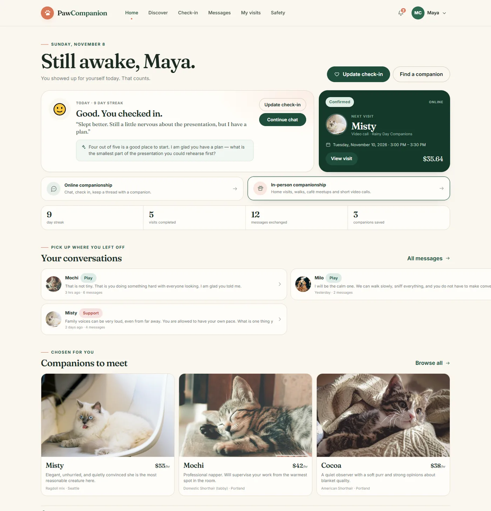

> **Status:** portfolio-ready demo. The product is complete enough to review end to end; payments are sandboxed, companion chat requires a configured model provider, and the safety operations are not a 24/7 clinical service. I would not put real users on this build without the launch work listed at the bottom.

**Stack:** React 19 · Vite 8 · Express 4 · MongoDB · Zod · JWT sessions · Playwright · Docker · GitHub Actions

**Verified:** 50 backend tests · 10-step Playwright E2E · green CI · Docker Compose smoke test

---

## The idea

Most apps for lonely pet lovers stop at a listing or a feed. The actual need is a relationship that shows up between visits.

PawCompanion makes that relationship concrete:

- **Online:** a daily check-in, a private journal, and a **digital pet** with a host-authored personality, private state, memory, animal vocalizations and translated text. Support mode is there when the day is heavy.
- **Offline:** a home visit, a walk or a café meetup. Real availability, a real host decision, a real refund path.
- **Around it:** browsing, favourites, notifications, bookings, reviews, a partner console and an operator safety queue.

The design constraints were deliberate: low pressure, no engagement dark patterns, no diagnosis language, and no pretending that a sandbox payment is real.

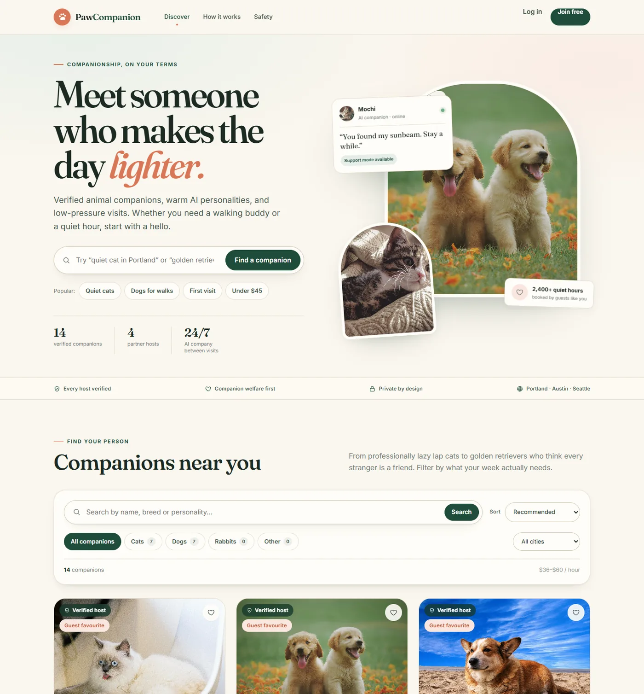

---

## Product tour

### 1. A member home that is about today, not a catalogue

The signed-in home starts with a check-in, the next visit, the conversations you can continue, and a small set of recommendations. Discovery is below, not the first thing you see.

### 2. Online companionship: check in, talk, keep a thread

| Daily check-in | Digital pet |
| --- | --- |
| 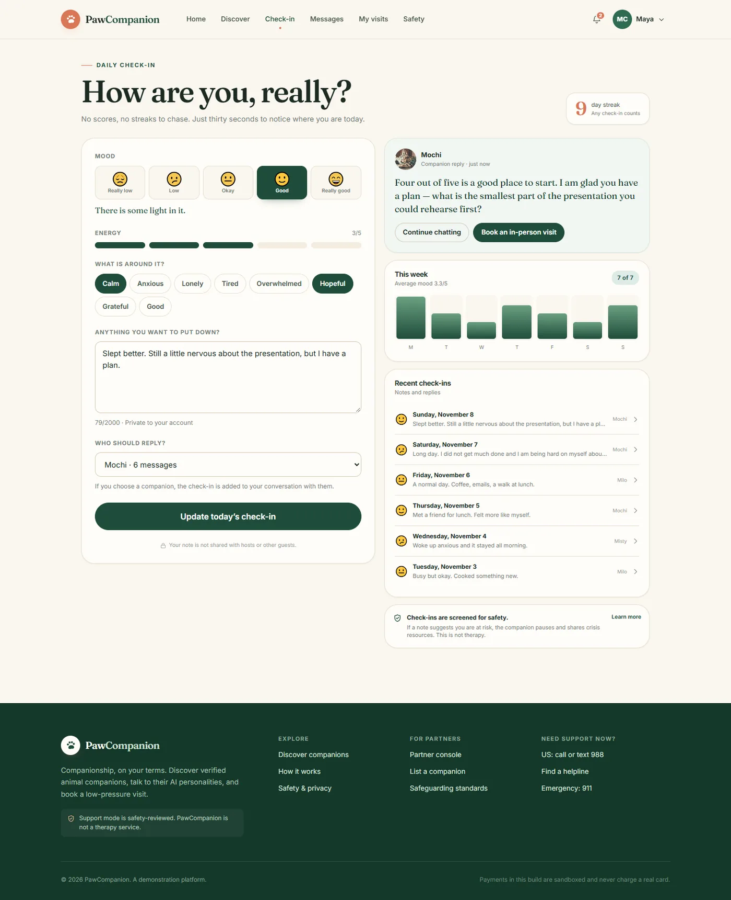 | 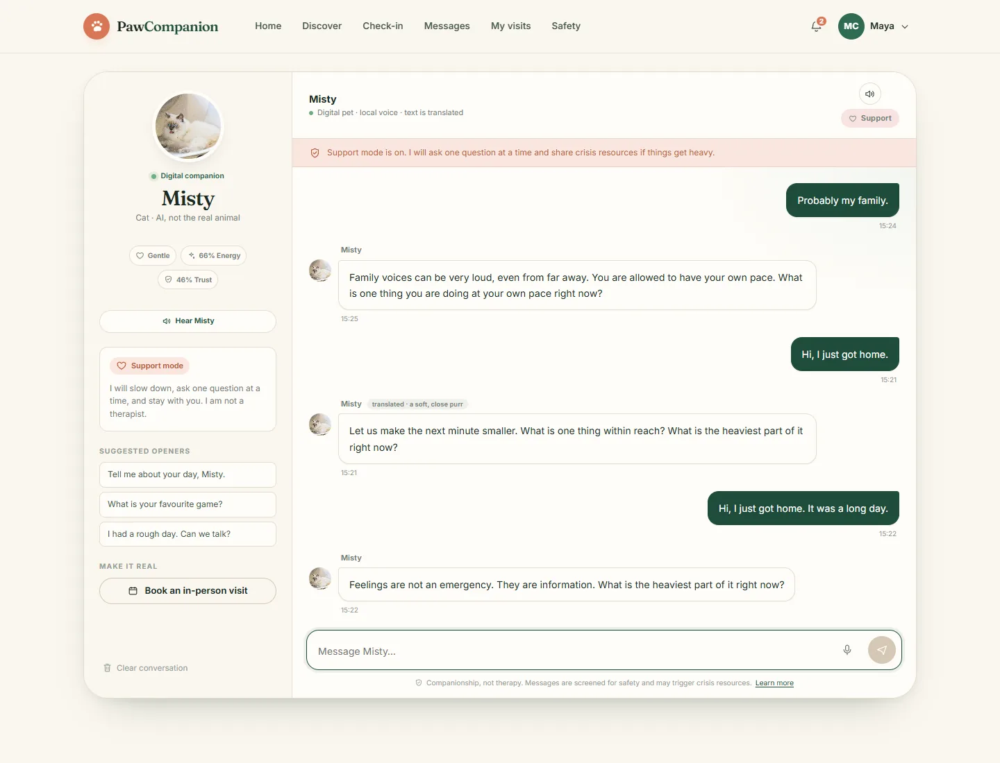 |

- One check-in per day: mood, energy, tags and an optional private note.
- The online companion is a **digital pet**: the app plays a species-appropriate animal sound (meow, purr, bark) and shows the human-language translation. It does not use human TTS or pretend to be the real animal.
- The host supplies the personality profile: traits, routines, favourites, comforts and boundaries. A deterministic behaviour planner sets mood/body/animation, then the LLM writes the short in-character line.
- Push-to-talk is available where the browser supports the Web Speech API; the transcript goes through the same text path.
- Support mode is chosen from intent, not sentiment. A high-risk message interrupts the model and returns crisis resources, not a playful sound.
- Chat memory and a provider router (primary + fallback model) share the same safety layer. Production chat fails closed with a 503 if no provider is configured; local persona stubs are test-only.

### 3. A companion profile that connects the two tracks

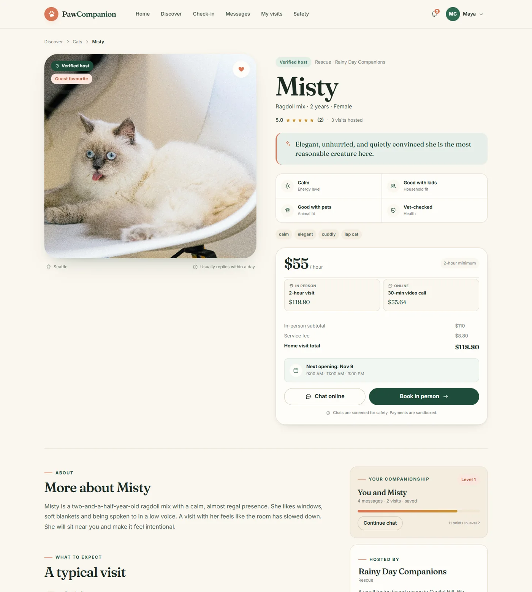

The profile shows the host, reviews, the next opening, in-person pricing, and — for a signed-in guest — the private bond built from messages, visits and favourites.

### 4. Offline companionship: a booking that behaves like a real one

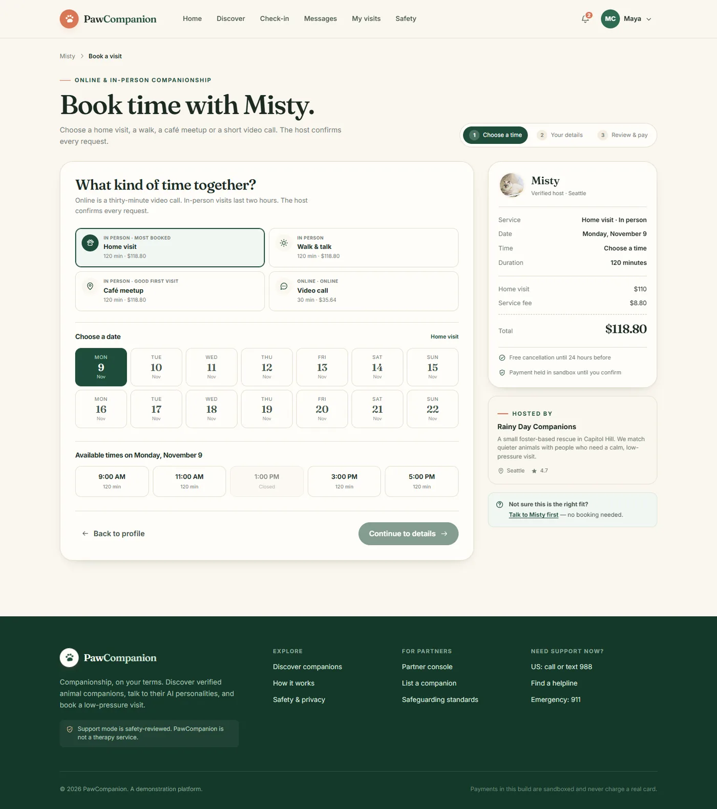

- Three services: home visit, walk & talk, café meetup.
- Server-computed pricing with an 8% service fee; the client never sends a price.
- Atomic slot reservation, 2-booking daily cap, host accept/decline, reschedule, cancellation with refund, completion and a review that recomputes ratings.
- The same visit appears correctly in the guest’s **My visits** and the partner’s **Bookings**.

### 5. Partner console

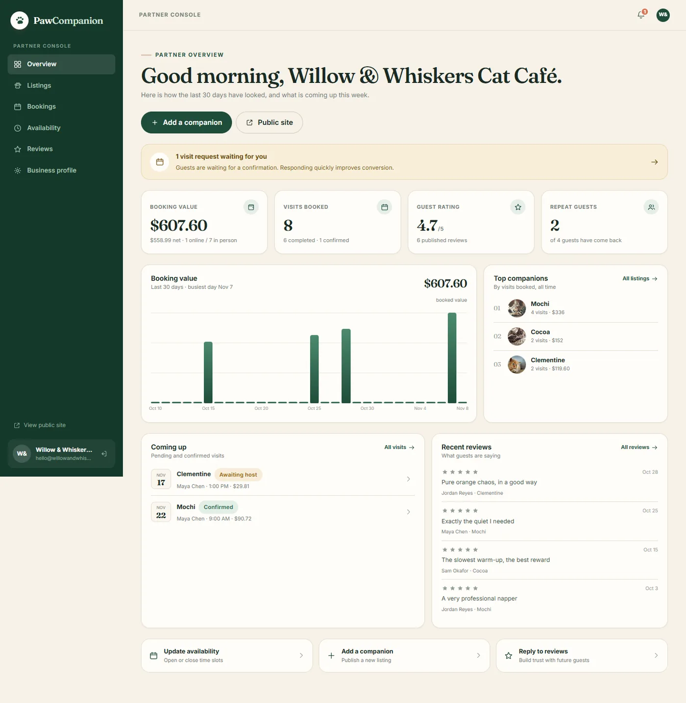

- A 30-day dashboard with booking value, online/in-person split, repeat guests, top companions and recent reviews.
- Listings with photo upload, 21-day availability, visit decisions, review replies and business profile.
- A partner can see the guest contact needed for a visit, but never the guest’s chat or check-in data.

### 6. Operator console

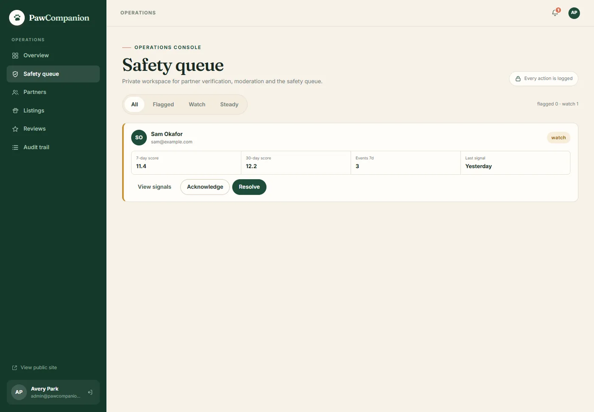

- Safety queue with derived scores and timestamps — **no raw conversation text**.
- Acknowledge/resolve, partner suspension, listing/review moderation and an append-only audit trail.
- Every operator action is recorded and every queue decision is explicit.

### 7. A real mobile shell

<p align="center">
  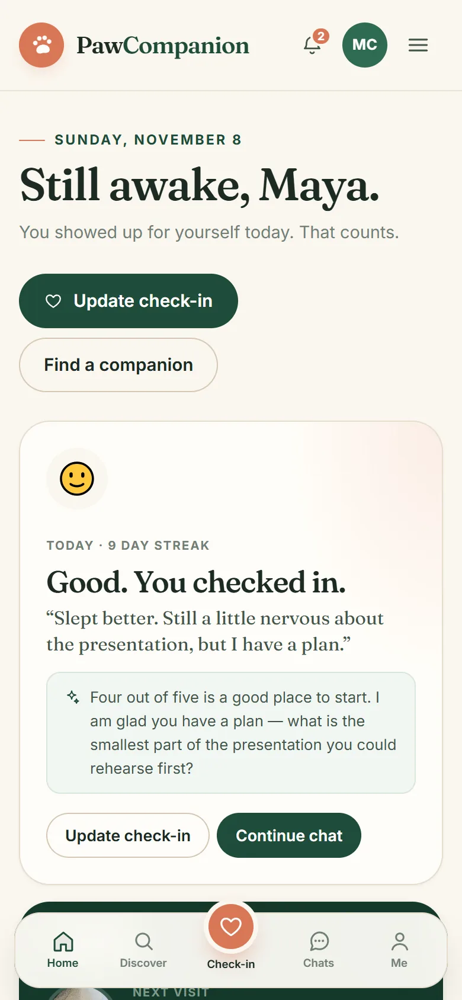
  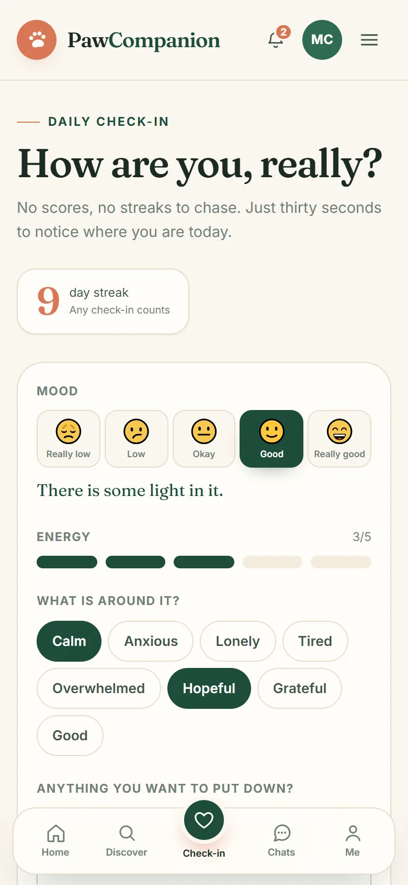
</p>

Bottom navigation, safe-area spacing, touch-sized controls, no horizontal overflow, PWA manifest and install shortcuts.

---

## Demo

Requires **Node.js 24+**.

```bash
npm --prefix backend ci
npm --prefix frontend ci
npm run demo
```

This starts an in-memory MongoDB, seeds the demo, starts the API on `:5000` and the web app on `:3000`. The first run downloads a MongoDB binary once.

Companion chat is provider-first. Set `LLM_PRIMARY_API_KEY` and `LLM_PRIMARY_MODEL` (and `ENABLE_AI=true`) for the digital pet; without a provider the chat endpoint returns `503` instead of a keyword reply. The explicit local stub is test-only (`ALLOW_LOCAL_FALLBACK=true` is for tests, not production).

| Role | Email | Password |
| --- | --- | --- |
| Guest | `maya@example.com` | `PawCompanion!2026` |
| Partner | `hello@willowandwhiskers.example` | `MerchantDemo!2026` |
| Operator | `admin@pawcompanion.app` | `AdminDemo!2026` (local demo only) |

Docker demo: `docker compose up --build` → `http://localhost:8080`.

All seed identities, reviews and visits are fictional demo data.

---

## How it works

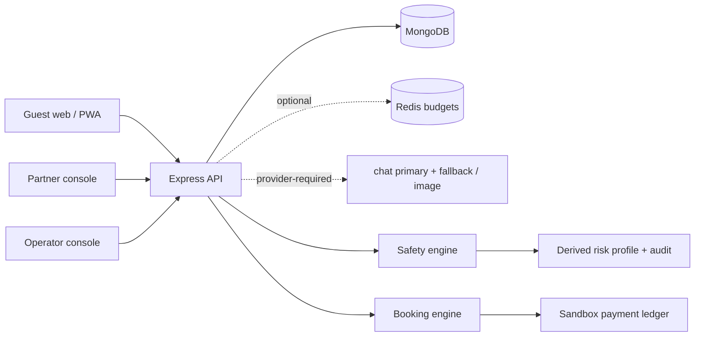

**Online track:** `POST /checkins` → safety screen → companion reply → check-in row + chat memory.

**Offline track:** service → slot → atomic booking → sandbox payment → host decision → completion → review.

**Auth:** short-lived access JWT in memory + rotating refresh session in an HttpOnly cookie. Every request validates the session row, so logout and password changes are immediate.

More detail: [Architecture.md](Architecture.md), [API reference](docs/API.md), [Safety model](docs/SAFETY.md).

---

## Three hard problems

**1. Trust is not a footer disclaimer.**

High-risk language is detected before any model call. The reply becomes a crisis card with real resources. Risk events store a level and timestamp, never the message. Operators see only derived signals. The guest can delete all companion data.

**2. A booking is a state machine, not a POST.**

A partial unique index guarantees one live booking per companion/date/start time. Cancellations release the slot and refund the sandbox payment. Confirmed past visits are swept to completed; unconfirmed past requests are declined and refunded. Reviews are only possible once, after completion.

**3. Continuity is the product.**

The same companion appears in discovery, chat, check-in, favourites and visits. Messages, visits and favourites create a bond; the next visit, active chats and the check-in live on the member home. That continuity is why this feels like an app rather than a directory.

---

## Engineering

```bash
npm test              # 50 backend tests
npm run build         # lazy route chunks, no source maps
npm run e2e           # 10-step smoke test (demo + provider configured)
npm run check:privacy # scan tracked files for local paths / key material
```

- **Backend:** routers → services → models; Zod at every boundary; stable serializers; central error handling; request IDs and structured logs.
- **Auth:** rotating refresh sessions hashed in MongoDB, HttpOnly/SameSite cookies, per-email/IP credential budgets, session list/revoke, password change, account closure.
- **Rate limits:** shared Redis budgets when configured, bounded memory fallback for a single-instance demo.
- **Data integrity:** partial unique booking index, one check-in per day, one review per visit, one conversation per companion.
- **Frontend:** design tokens + CSS Modules, auth gate before route mount, route-level lazy loading, accessible dialogs/pickers, PWA service worker.
- **Deployment:** backend/frontend Dockerfiles, a full-stack Render image, nginx same-origin proxy, compose demo, health/readiness, graceful shutdown.
- **Docs:** [case study](docs/CASE_STUDY.md), [architecture](Architecture.md), [API](docs/API.md), [safety](docs/SAFETY.md), [deployment](docs/DEPLOYMENT.md), [publishing](docs/PUBLISHING.md).

### Repository map

```
backend/src/
  routers/        auth, me, checkins, animals, favorites, bookings, ai, notifications, merchant, admin
  services/       scheduling, availability, booking, checkin, review, safety, risk, session, AI,
                  digital pet behaviour/state, analytics
  models/         Customer, Merchant, Admin, Session, Animal, AnimalSound, Booking, Payment, Review,
                  Favorite, Checkin, ChatMemory, DigitalPetState, Notification, RiskEvent,
                  UserRiskProfile, AuditEvent
  validators/     Zod request contracts
  serializers/    stable API shapes
  lib/            errors, logger, validation, IDs, time
frontend/src/
  pages/          public, guest, partner, operator
  components/     layout, design primitives, companion cards, chat, dashboard
  context/        auth, toast, favorites
  lib/            API client, formatting, constants
  styles/         tokens, base, shared UI
```

---

## What I would build next

- **Live payments:** Stripe PaymentIntents, webhooks, idempotency keys, real refund reconciliation.
- **Deep audio embeddings:** wire a CLAP/YAMNet/PANNs provider to the existing acoustic-signature contract. Host uploads and per-animal palettes are already implemented.
- **Production safety ops:** on-call escalation, localised helplines, clinician-reviewed copy, consent and retention controls.
- **Recurring partner schedules:** weekly opening hours, holidays and travel time instead of per-date overrides.
- **Real-time layer:** WebSocket/SSE notifications and a shared host inbox.
- **PWA polish:** offline shell, install prompts and web push. Native shells and app-store distribution are intentionally out of scope; the product is a responsive web app.
- **Type contracts:** migrate to TypeScript and generate the client from OpenAPI.

---

## Honest limitations

This is not a production therapy or emergency service. It is companionship with a safety layer. There is no 24/7 human crisis team, no live payment processor, no email/SMS delivery, and no email verification or password reset. Native apps and app-store distribution are intentionally out of scope: this is a responsive web/PWA product. See [docs/SAFETY.md](docs/SAFETY.md) and [docs/PRODUCTION_SECURITY.md](docs/PRODUCTION_SECURITY.md) before any public launch.

## Publishing this project

The recommended setup is **one public code repo + one private deployment repo**: this repo is the portfolio and the complete implementation; the private repo holds only environment-specific infrastructure, secrets and operational configuration. It is also valid to keep one public repo and use GitHub Environments/Secrets. The decision, privacy checklist and launch path are in [docs/PUBLISHING.md](docs/PUBLISHING.md).

## Documentation

| File | Contents |
| --- | --- |
| [docs/CASE_STUDY.md](docs/CASE_STUDY.md) | Problem, users, product bets, metrics, launch plan |
| [Architecture.md](Architecture.md) | Domain model, flows, auth, safety, trade-offs |
| [docs/API.md](docs/API.md) | Endpoint reference and examples |
| [docs/SAFETY.md](docs/SAFETY.md) | Crisis detection, support mode, risk scoring, privacy |
| [docs/DIGITAL_PET.md](docs/DIGITAL_PET.md) | Digital pet state, behaviour planner, sound/text contract |
| [docs/SOUND_CREDITS.md](docs/SOUND_CREDITS.md) | Licensed animal sound sources |
| [docs/IMAGES.md](docs/IMAGES.md) | Merchant image pipeline, limits, demo-asset policy |
| [docs/PROVIDER_SETUP.md](docs/PROVIDER_SETUP.md) | **Start here:** keys to fill, where to get them, copy/paste block |
| [docs/PROVIDER_MATRIX.md](docs/PROVIDER_MATRIX.md) | Strongest task-specific provider stack, slots, 2D avatar runtime |
| [docs/PRIVACY_AUDIT.md](docs/PRIVACY_AUDIT.md) | Public-repo privacy audit, secret scanning, image metadata |
| [docs/DEPLOYMENT_SUPPORT.md](docs/DEPLOYMENT_SUPPORT.md) | Render + Atlas setup, required values, live-demo checklist |
| [docs/DEPLOYMENT.md](docs/DEPLOYMENT.md) | Docker, production configuration, operations |
| [docs/PUBLISHING.md](docs/PUBLISHING.md) | Public/private repo strategy and privacy audit |
| [CONTRIBUTING.md](CONTRIBUTING.md) | Local setup, tests, conventions |
| [CHANGELOG.md](CHANGELOG.md) | What changed in 2.0 |

## License

ISC. See [LICENSE](LICENSE).
