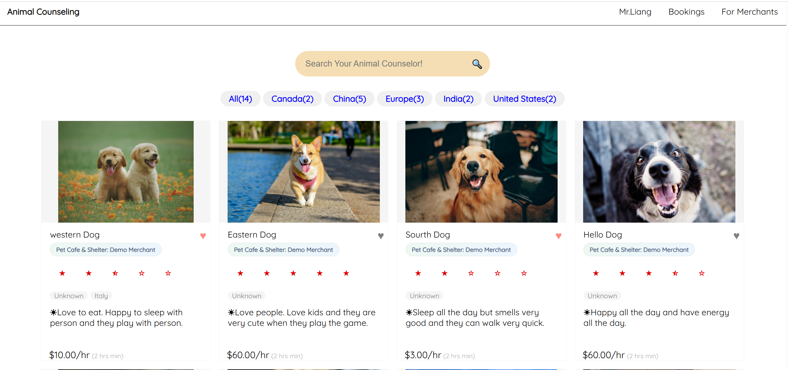
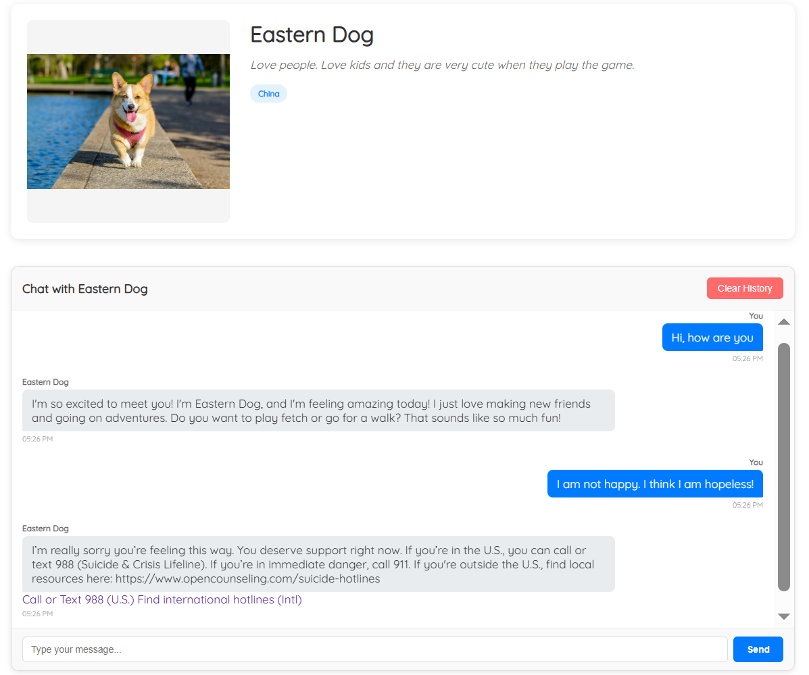
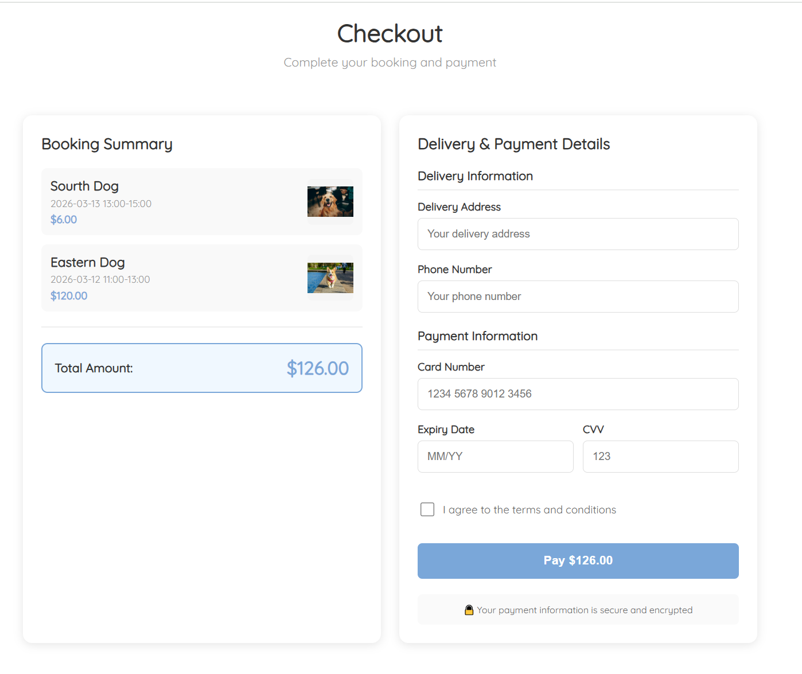

# PawCompanion — AI Pet Companion Platform

**Emotional-support chat, safety risk scoring, and pet visit booking in one full-stack app.**

[Run locally](#run-locally) · [Features](#features) · [Safety](#safety-and-risk-scoring) · [Documentation](#documentation)



## What it does

Browse adoptable pets, chat with each pet's AI personality, and book a 2-hour visit session.
Conversations are scanned for self-harm signals and feed a time-decayed risk profile
that can surface crisis resources. Payments and checkout are simulated.

## Features

- **Pet browsing** — search by name, filter by location tag, and open pet detail pages.
- **Booking list** — keep selected pets in a list that persists across refreshes (localStorage).
- **AI chat** — per-pet personalities, **play** and **support** modes (STF-N), automatic
  mode switching, per-user history, and image generation.
- **Booking** — pick a date and 2-hour time slot; price is the pet's rate × 2, and the address is entered at checkout.
- **Safety** — self-harm signal detection, 7-day and 30-day risk scores, and crisis helpline
  responses.
- **Merchant portal** — merchant login, listings, and order views.

<details>
<summary>More screenshots</summary>

| Chat modes and safety | Booking and checkout |
| --- | --- |
|  |  |

</details>

## Stack

React, Vite, React Router, and CSS Modules · Node.js and Express · MongoDB and Mongoose ·
Hugging Face Inference API for chat and image generation.

## Run locally

Requires Node.js 24+, npm, MongoDB (local or Atlas), and optionally a Hugging Face API key.

```bash
git clone https://github.com/Mike-Animal-Counseling/paw-companion.git
cd paw-companion
```

Backend:

```bash
cd backend
cp .env.example .env      # set MONGO_URI and a fresh JWT_SECRET
npm ci
npm run seed              # optional sample animals
npm run dev               # http://localhost:5000
```

Generate a secret with:

```bash
node -e "console.log(require('crypto').randomBytes(48).toString('base64url'))"
```

Frontend, in a second terminal:

```bash
cd frontend
npm ci
npm start                 # http://localhost:3000
```

To try AI responses, set `ENABLE_AI=true` and `HUGGINGFACE_API_KEY` in `backend/.env`.
Keep `CORS_ORIGIN=http://localhost:3000` for local use.

## Safety and risk scoring

Each message is analysed in memory before a model call. Flagged messages return a crisis
response and helpline numbers; other messages update a time-decayed risk score stored in
MongoDB. `flagged` requires `score30d >= 18` or two high-risk events within 7 days;
`watch` requires `score7d >= 10`; everything else is `ok`.

## Known limitations

- Checkout and payment are prototypes; production checkout and booking changes stay
  disabled until real payments and atomic reservations are integrated.
- Animal data is seeded; there is no admin CMS.
- Image generation needs an active Hugging Face key.

## Documentation

| File | Contents |
| --- | --- |
| [Architecture.md](./Architecture.md) | Design decisions, full review, and feature status |
| [backend/README.md](./backend/README.md) | Backend setup and endpoint reference |
| [AI_SETUP_GUIDE.md](./backend/AI_SETUP_GUIDE.md) | Hugging Face configuration |
| [TEST_GUIDE.md](./backend/TEST_GUIDE.md) | Manual and automated tests |

## Security

Read the [security policy](SECURITY.md) and
[production requirements](docs/PRODUCTION_SECURITY.md) before deployment.
