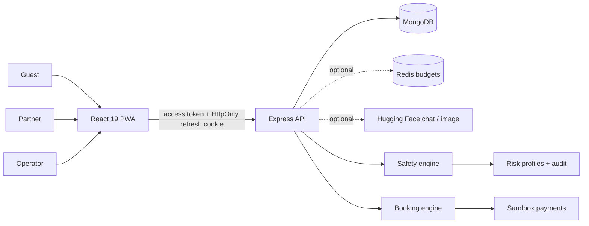

# PawCompanion

**An online + in-person pet companionship product.**
Chat with a companion's AI personality, check in with yourself every day, and book a real visit 閳?a home visit, a walk, a caf鑼?meetup or a short video call.

[Quick start](#quick-start) 璺?[Product](#the-product) 璺?[Architecture](#architecture) 璺?[Testing](#engineering) 璺?[Documentation](#documentation)


## The product

Most pet apps stop at a listing. PawCompanion is built as a companionship service with two tracks that share one relationship:

| | Online companionship | In-person companionship |
| --- | --- | --- |
| **What it is** | An AI companion with a consistent personality, memory and a safety-aware support mode | Two-hour visits, walks, caf鑼?meetups and 30-minute video calls with a real companion and host |
| **When** | Any time, especially between visits | Booked in advance, confirmed by the host |
| **Core systems** | Daily check-ins, mood journal, conversation memory, companion bond, crisis screening, risk profiles | Service catalogue, availability, atomic slot booking, sandbox payments/refunds, host decisions, rescheduling, reviews |
| **Where it lives** | `/check-in`, `/chat/:id`, `/chats` | `/companions/:id`, `/book/:id`, `/visits` |

### Online track

- **Daily check-in and journal.** A 30-second mood/energy check-in with optional tags and a private note. The chosen companion replies, the check-in joins the same conversation thread, and a streak plus a seven-day mood chart make the relationship visible without turning it into a score.
- **AI companion chat.** Each animal has a personality profile, a tone and a memory. The app works without an API key via a local persona fallback; adding `HUGGINGFACE_API_KEY` upgrades the same flows to a hosted model.
- **Support mode.** Distress is detected locally before any model call. The companion switches to a slower STF-N style, asks one question at a time and never claims to be a therapist.
- **Safety, not a disclaimer.** High-risk language interrupts the conversation with crisis resources. Derived risk events (level + timestamp, never raw text) feed a decaying profile that operators can review.
- **Bond and continuity.** Messages, completed visits and favourites accumulate into a private bond level on the companion profile.

### In-person track

- **Four service types.** Home visit, walk & talk, caf鑼?meetup and a 30-minute online video call 閳?priced from the companion's hourly rate with a transparent service fee.
- **Real booking mechanics.** Atomic slot reservation (one live booking per companion/date/time), two-booking daily limit, host confirmation, rescheduling more than 24 hours ahead, cancellation with automatic sandbox refund.
- **Visit lifecycle.** `pending 閳?confirmed 閳?completed`, or `cancelled`/`declined`; a status timeline, receipt, host notes and guest notes travel with every visit.
- **Reviews that close the loop.** Only completed visits can be reviewed, once. Ratings recompute the companion and host aggregates; hosts can reply publicly.
- **Merchant operations.** Listings, photo upload, 21-day availability calendar, visit decisions, review replies, business profile and a 30-day dashboard split into online/in-person channels.
- **Operator console.** Safety queue, partner suspension, listing/review moderation and an append-only audit trail.

<p align="center">
  
  
</p>

## Quick start

### Option A 閳?one command, in-memory database

Requires **Node.js 24+** and npm. First install the two apps, then run the demo:

```bash
npm --prefix backend ci
npm --prefix frontend ci
npm run demo
```

`npm run demo` starts an in-memory MongoDB, seeds the full demo (4 hosts, 14 companions, chats, check-ins, visits and reviews), starts the API on `:5000` and the web app on `:3000`. The first run downloads a MongoDB binary once.

| Role | Email | Password |
| --- | --- | --- |
| Guest | `maya@example.com` | `PawCompanion!2026` |
| Partner | `hello@willowandwhiskers.example` | `MerchantDemo!2026` |
| Operator | `admin@pawcompanion.app` | `AdminDemo!2026` |

### Option B 閳?Docker Compose

```bash
docker compose up --build
```

Open `http://localhost:8080`. The compose stack runs MongoDB, the API, the seed and an nginx-served production bundle. It is a demo configuration: sandbox payments, no real money, demo credentials enabled.

### Option C 閳?your own MongoDB

```bash
cd backend
cp .env.example .env
# set MONGO_URI and a fresh JWT_SECRET
npm ci
npm run seed        # adds the same demo data, resetting demo collections
npm run dev         # API :5000
```

```bash
cd frontend
cp .env.example .env
npm ci
npm run dev         # web :3000 (proxies /api and /uploads to :5000)
```

Generate a secret with:

```bash
node -e "console.log(require('crypto').randomBytes(48).toString('base64url'))"
```

## Screenshots

| Guest discovery | Booking a real visit |
| --- | --- |
|  |  |

| Partner dashboard | Operator safety queue |
| --- | --- |
|  |  |

| Mobile app home | Mobile check-in |
| --- | --- |
|  |  |

## Architecture



- **Frontend:** React 19, React Router 7, Vite 8, CSS Modules over a token-based design system, route-level code splitting, PWA manifest/service worker, accessible mobile tab bar.
- **Backend:** Express 4 with a layered split 閳?`routers/` (HTTP), `services/` (domain), `models/` (Mongo), `validators/` (Zod), `serializers/` (API shape), plus shared `lib/` helpers for errors, logging, IDs and time.
- **Auth:** short-lived access JWT in memory, rotating refresh token in an `HttpOnly`, `SameSite=Lax` cookie stored as a hashed session row. Logout and refresh invalidate the session immediately; password changes revoke other devices.
- **Data integrity:** a partial unique index enforces one live booking per companion/date/start time; booking creation is a real reservation, not a client-side cart.
- **Multi-role:** guest, partner and operator accounts are separate collections with shared session and role guards.
- **Operations:** request IDs, structured JSON logging, `/api/health` and `/api/ready`, graceful shutdown, 30-minute booking sweep, daily risk scan, append-only audit events.

Read [Architecture.md](Architecture.md) for the full design and trade-offs.

## Engineering

```bash
npm test          # 41 backend tests: auth, RBAC, bookings, check-ins, safety, security
npm run build     # production frontend build (route-level chunks, no source maps)
npm run demo      # in-memory DB + seed + API + web
npm run seed      # reset the demo data against MONGO_URI
```

Optional browser smoke test (with the demo running and Edge/Chrome installed):

```bash
npm ci
npm run e2e
```

- **Validation:** every body, query and route parameter is parsed by Zod; object-shaped NoSQL payloads fail before a query.
- **Rate limits:** shared per-IP, per-account, per-user and global budgets; Redis-backed when `REDIS_URL` is set, memory-backed for a single instance.
- **Safety tests:** high/medium/none classification in English and Chinese, crisis card resources, risk-profile updates, check-in screening.
- **Booking tests:** service pricing, duplicate-slot conflicts, ownership checks, rescheduling, refunds, review eligibility and rating recomputation.
- **CI:** locked installs, `npm audit`, backend tests, frontend build and a source-map check (`.github/workflows/application.yml`).
- **Deployment:** backend/frontend Dockerfiles and a compose demo; see [docs/DEPLOYMENT.md](docs/DEPLOYMENT.md).

### Repository map

```
backend/
  src/
    config/        env validation, Mongo connection
    middleware/    auth, request context, error handling
    models/        Customer, Merchant, Admin, Session, Animal, Booking, Payment,
                   Review, Favorite, Checkin, Notification, ChatMemory, RiskEvent, ...
    routers/       auth, me, checkins, animals, favorites, bookings, ai,
                   notifications, merchant, admin
    services/      scheduling, availability, booking, checkin, review, safety,
                   risk scoring, session, AI, image generation, analytics, audit
    scripts/       seed, demo
  tests/           41 integration/unit tests
frontend/
  src/
    components/    design-system primitives, layout, companion cards, chat, dashboard
    context/       auth, toast, favorites
    pages/         public, guest, partner and operator screens
    styles/        tokens, base, shared UI
    lib/           API client, formatting, constants
docs/              API, deployment, safety, production security, screenshots
```

## Documentation

| File | Contents |
| --- | --- |
| [Architecture.md](Architecture.md) | Domain model, online/offline flows, auth, safety, trade-offs |
| [docs/API.md](docs/API.md) | Endpoint reference, response envelope, examples |
| [docs/SAFETY.md](docs/SAFETY.md) | Crisis detection, support mode, risk scoring, privacy limits |
| [docs/DEPLOYMENT.md](docs/DEPLOYMENT.md) | Docker, production configuration, operations checklist |
| [docs/PRODUCTION_SECURITY.md](docs/PRODUCTION_SECURITY.md) | Supported production boundary |
| [CONTRIBUTING.md](CONTRIBUTING.md) | Local setup, tests, project conventions |
| [CHANGELOG.md](CHANGELOG.md) | What changed in 2.0 |

## Safety and honest limitations

PawCompanion is **companionship, not therapy or medical care**. It is not monitored 24/7 by a human crisis team. High-risk messages surface crisis resources (US 988, findahelpline.com, emergency services) and feed a private review queue; they do not contact emergency services on the guest's behalf.

**Payments are sandboxed.** There is no live card processor in this build. The sandbox creates a real, auditable payment and refund record so the booking lifecycle is complete, but no money moves. A production deployment must either integrate a live provider or explicitly acknowledge demo mode with `ALLOW_SANDBOX_PAYMENTS=true`.

AI is optional. With `ENABLE_AI=false` the product uses a local persona fallback and remains fully usable; with a key it upgrades chat and image generation while keeping the same safety layer. See [SECURITY.md](SECURITY.md) and [docs/PRODUCTION_SECURITY.md](docs/PRODUCTION_SECURITY.md).

## License

ISC. See [LICENSE](LICENSE).
