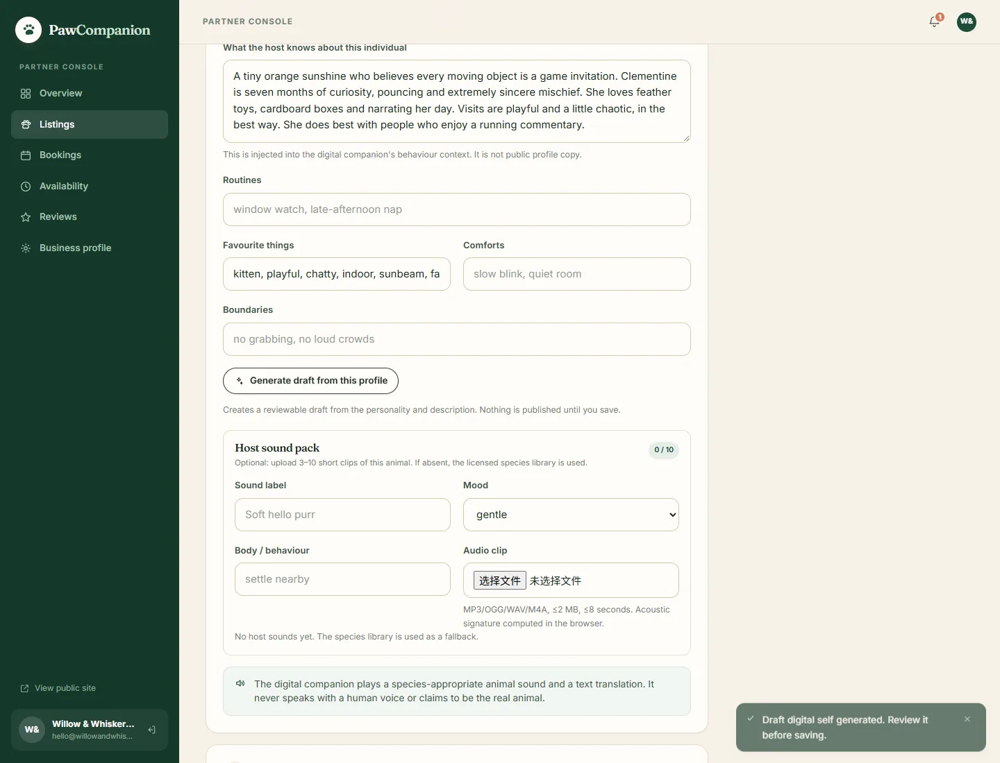

# Digital pet

PawCompanion's online track is a **digital companion**, not a host video call. The offline track remains real in-person visits.

> The digital pet never claims to be the real animal. Its audio is a species-appropriate animal sound; its chat text is the translation.

## What is implemented

### Companion profile

Each listing can carry a `digital` profile (host-editable in the partner listing form):

- `enabled` — host consent to operate a digital self
- `voice` — cat / dog / rabbit / other
- `traits` — energy, sociability, curiosity, anxiety, playfulness (1–5)
- `routines`, `favorites`, `comforts`, `boundaries`
- `hostNotes` and `voiceStyle`

The profile is injected into the LLM system prompt. It is not public profile copy.



### Per-user state

`DigitalPetState` stores a private relationship state for each guest + companion:

- mood, energy, attention, trust, interaction count
- last sound key and last interaction time

State is updated after each turn: play lowers energy, support raises trust, sleep recovers energy. The response includes the updated state so the UI can show it.

### Behaviour planner

A deterministic planner selects a mood before the LLM responds:

| State | Body | Animation |
| --- | --- | --- |
| `gentle` | settle nearby | slow blink |
| `playful` | bring a toy | bounce |
| `affectionate` | lean in | blink |
| `sleepy` | curl up | yawn |
| `shy` | peek | ear twitch |
| `alert` | perk up | head tilt |

The LLM receives the mood, body, sound and profile context, and writes short in-character text. It cannot choose an arbitrary audio file; the planner chooses from the allowed palette.

### Animal sound + text translation

- The app plays a short species sound (cat meow/purr/trill, dog bark/play/soft) or a host-uploaded clip.
- Text is shown as the translation, with a `translated · <sound label>` badge.
- No human TTS and no human voice is used for the animal.
- The licensed fallback library lives in `frontend/public/sounds`; see [SOUND_CREDITS.md](SOUND_CREDITS.md).
- Hosts can upload MP3/OGG/WAV/M4A clips (≤2 MB, ≤8 seconds) with a mood/behaviour label. The server validates duration/codec; the browser computes a 24-dimensional acoustic signature (`paw-acoustic-v1`) and stores it with the sound.
- Host sounds take priority for the matching mood; the species library remains the fallback.

### Voice input

The chat composer supports push-to-talk in browsers that expose the Web Speech API. The transcript goes through the same text-chat path; the animal still replies with a sound + translated text.

### Safety

- High-risk text returns the existing crisis card; the digital pet does not play a playful sound and does not replace the resources with a meow.
- Guest can mute sound.
- `prefers-reduced-motion` disables avatar animation.
- The UI states "AI, not the real animal" and "text is translated".

## Not implemented yet

- Deep semantic audio embeddings (CLAP/YAMNet/PANNs). The current signature is an RMS/zero-crossing acoustic fingerprint, not a provider embedding.
- LLM-based trait extraction. The current draft is deterministic keyword scoring, explicitly reviewable by the host; a provider can replace it behind the same API.
- 2D rigged avatar; the current avatar is a portrait with lightweight CSS motion.
- Real-time voice streaming and video. These are out of scope.

The provider seam is intentionally small: add `AUDIO_EMBEDDING_PROVIDER`, `AUDIO_EMBEDDING_API_KEY` and `AUDIO_EMBEDDING_MODEL` to the environment, then replace the browser signature with the provider vector (same `analysis.embedding` contract).

## Host onboarding target

```text
host creates listing
  → digital profile fields + host notes
  → optional 3–10 sound clips with mood labels
  → audio analysis / embedding adapter
  → generated draft palette + behaviour matrix
  → host preview
  → publish
```

The current form supports profile fields, a deterministic draft, and host sound upload with the acoustic signature. Deep provider embeddings and LLM extraction are the next layer, not something this build pretends to have.

## API

`POST /api/ai/chat` now includes:

```json
{
  "digital": {
    "mood": "gentle",
    "behaviour": "settle_nearby",
    "animation": "slow_blink",
    "sound": { "key": "cat-purr-0", "url": "/sounds/cat-purr.mp3", "label": "a soft, close purr", "rate": 0.9 },
    "state": { "mood": "gentle", "energy": 68, "attention": 66, "trust": 43, "interactions": 1 }
  }
}
```

`GET /api/ai/conversations/:animalId` returns the profile, current state and host sound list.

Partner endpoints:

| Method | Path | Purpose |
| --- | --- | --- |
| POST | `/api/merchant/animals/:id/digital/draft` | Deterministic profile draft from listing copy |
| GET | `/api/merchant/animals/:id/sounds` | Host sound pack |
| POST | `/api/merchant/animals/:id/sounds` | Multipart `audio` + label/mood/behaviour/embedding |
| DELETE | `/api/merchant/sounds/:soundId` | Owner-only removal |

## Design rules

1. Sound is animal vocalization; text is translation.
2. The host's profile is the source of personality; the LLM is the renderer.
3. State changes should be small and legible, not a hidden engagement loop.
4. Never imply the digital pet is conscious, the real animal, or a replacement for care.
5. A digital self requires host opt-in and revocation.
