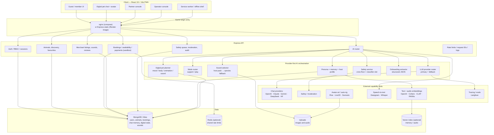
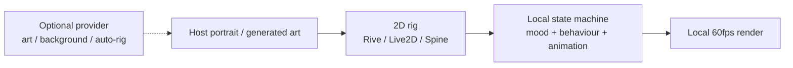
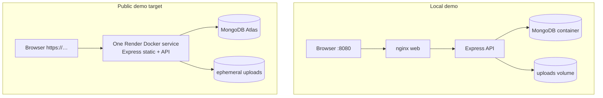

# Project summary

One page for the current PawCompanion scope, architecture and remaining gaps.

## What this project is

A responsive web/PWA pet-companionship product with two tracks:

- **Online:** a digital pet with host-authored personality, animal sounds,
  translated text, private relationship state, memory and a crisis-aware safety
  layer.
- **Offline:** real home visits, walks and café meetups with verified hosts.
- **No host video calls.** The old `video_call` SKU was removed from the
  catalogue, seed, API, UI and docs.

## What changed from the original demo

| Area | Change |
| --- | --- |
| Scope | Responsive web + installable PWA only; no native shell |
| Online track | Host video call → digital pet (animal vocalization + text translation) |
| Offline services | Home visit, walk, café meetup only |
| Digital identity | Host-authored voice/traits/routines/favourites/comforts/boundaries |
| State | Per-user `DigitalPetState`: mood, energy, attention, trust, interactions |
| Behaviour | Deterministic planner chooses mood/body/animation/sound; LLM writes the line |
| Sounds | Licensed species library + host sound packs with duration/codec validation |
| Audio signature | Browser `paw-acoustic-v1`; deep provider slot reserved |
| Onboarding | Model-first structured extraction; test-only local draft |
| AI | Provider-first primary + fallback; production fails closed with 503 |
| Safety | Hard crisis floor + classifier slot; crisis text overrides playful sounds |
| Voice input | Browser Web Speech API push-to-talk |
| Host console | Digital profile editor, draft generation, sound upload/delete |
| Deployment | One-service Render image; Docker Compose for local |
| Privacy | Public-repo audit, secret/code scanning, no tracked runtime files |
| Admin demo | Public demo generates a private admin password |

## Current architecture



## Digital-pet request flow

```mermaid
sequenceDiagram
  participant U as Guest
  participant C as Chat UI
  participant A as API router
  participant S as Safety service
  participant D as Digital pet service
  participant P as Provider router
  participant M as MongoDB

  U->>C: text or push-to-talk
  C->>A: POST /api/ai/chat
  A->>S: hard crisis patterns + optional classifier
  alt crisis
    S-->>A: flagged
    A->>M: store crisis turn
    A-->>C: crisis resources + gentle state, no playful sound
  else normal
    A->>M: load host sounds + digital state + memory
    A->>D: plan mood/body/animation/sound
    D-->>A: plan
    A->>P: primary model; fallback on error
    P-->>A: translated text
    A->>M: persist turn + update digital state
    A-->>C: text + digital metadata
    C->>C: play animal sound, show “translated” badge
  end
```

## 2D avatar architecture



Runtime animation is intentionally local. A provider is only for offline asset
generation or an auto-rig experiment. There is no reliable one-click 2D auto-rig
API, so a human rig pass is expected.

## Deployment topology



The Render target is defined by `render.yaml` + `Dockerfile.render`; the
same-origin design avoids cross-site refresh-cookie problems.

## Verification

- 50 backend tests
- 10-step Playwright E2E suite (requires a configured provider for chat)
- Frontend production build
- CodeQL / secret scanning / public-source security in CI
- Privacy scan across tracked files
- Docker Compose and full-stack Render image both exercised locally

## Current gaps

| Gap | Status |
| --- | --- |
| Live chat provider | keys not configured; production 503 by design |
| Safety/moderation adapter | slot reserved; hard crisis floor active |
| Deep text/audio embeddings | text slot reserved; audio uses local acoustic signature |
| STT | browser Web Speech API; server STT slot reserved |
| 2D rigged avatar | portrait + CSS motion; Rive/Live2D not integrated |
| Public URL | blocked on Render account + Atlas URI |
| Real payments | sandbox only |
| Email / password reset | not implemented |

Provider keys and the fill-in checklist are in
[PROVIDER_SETUP.md](PROVIDER_SETUP.md). The full stack rationale is in
[PROVIDER_MATRIX.md](PROVIDER_MATRIX.md).
