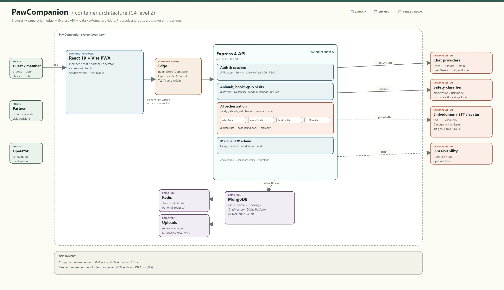

# System architecture

PawCompanion runs as a same-origin web/PWA: a React client talks to an Express API, the API owns the digital-pet state and booking domain, and provider slots sit behind the AI layer.

- **Online:** host-authored digital pet, per-user relationship state, animal sounds, translated text and a crisis-aware safety gate.
- **Offline:** home visits, walks and café meetups.
- **Data:** MongoDB for identity, listings, bookings, memory and digital state; audio/images on upload storage.
- **Providers:** chat primary/fallback, safety, embeddings, STT and avatar generation are slots, not hard dependencies. Solid lines are current paths; dashed lines are optional/provider slots.

The runtime 2D avatar is local (Rive/Live2D/Spine); providers are only for offline art or auto-rig.

For implementation detail, see [Architecture.md](../Architecture.md). To fill provider keys, see [PROVIDER_SETUP.md](PROVIDER_SETUP.md).
